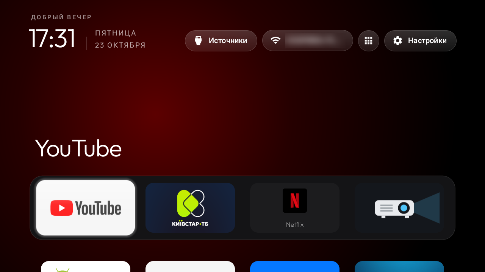
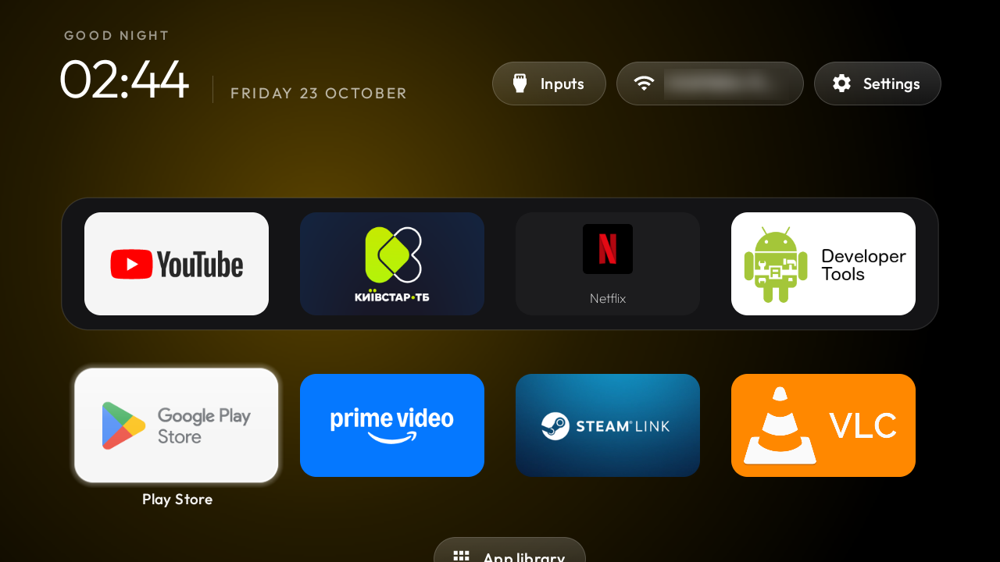
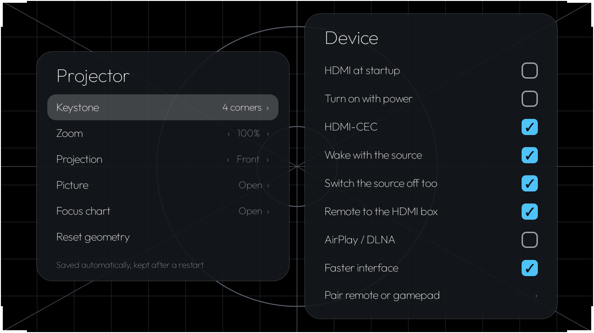
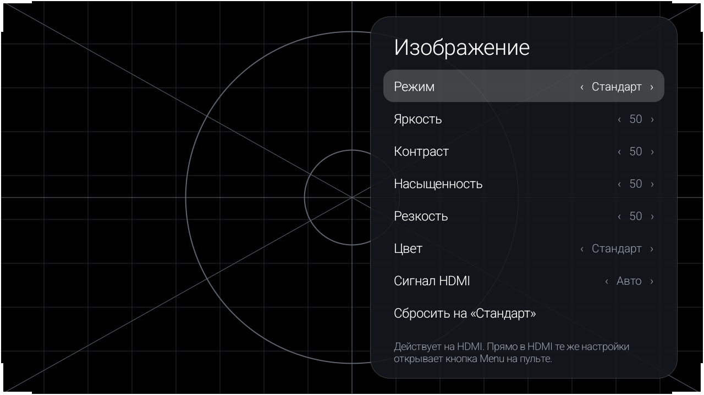
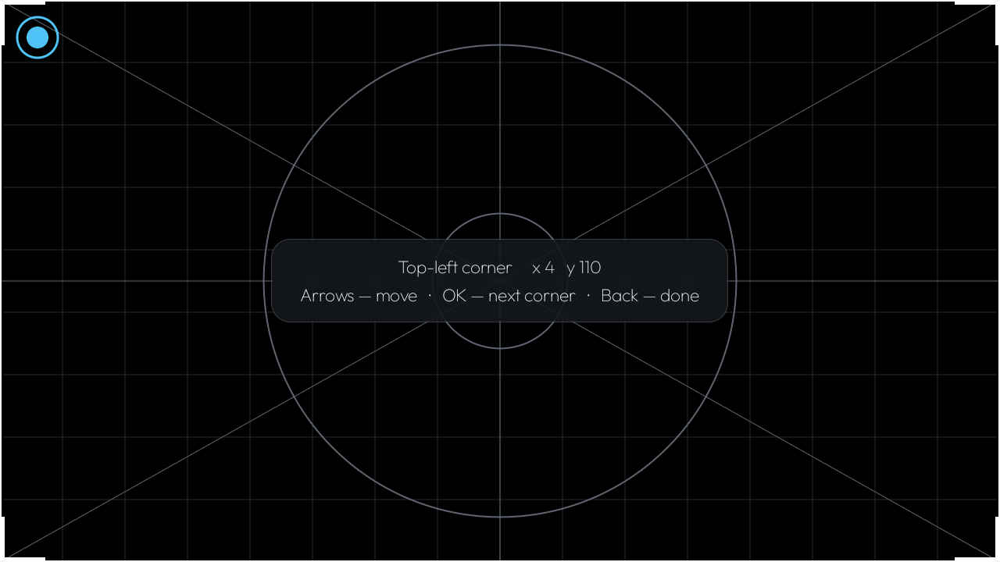
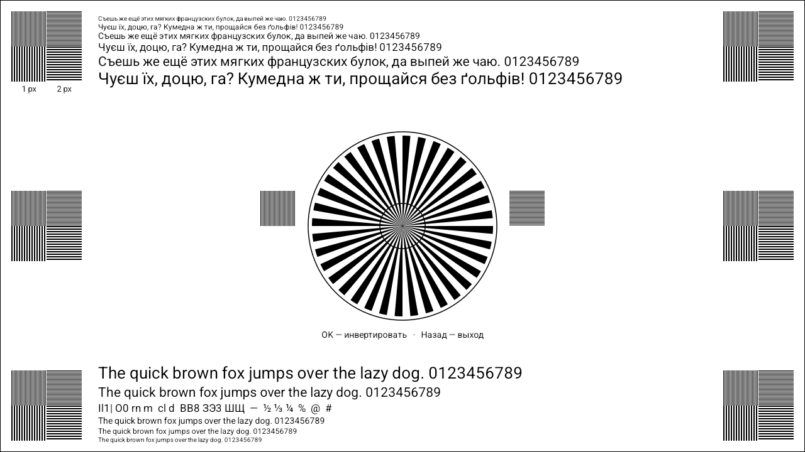
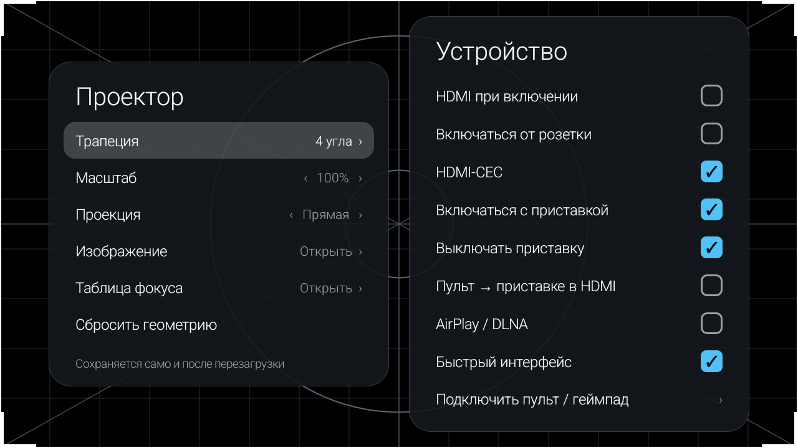
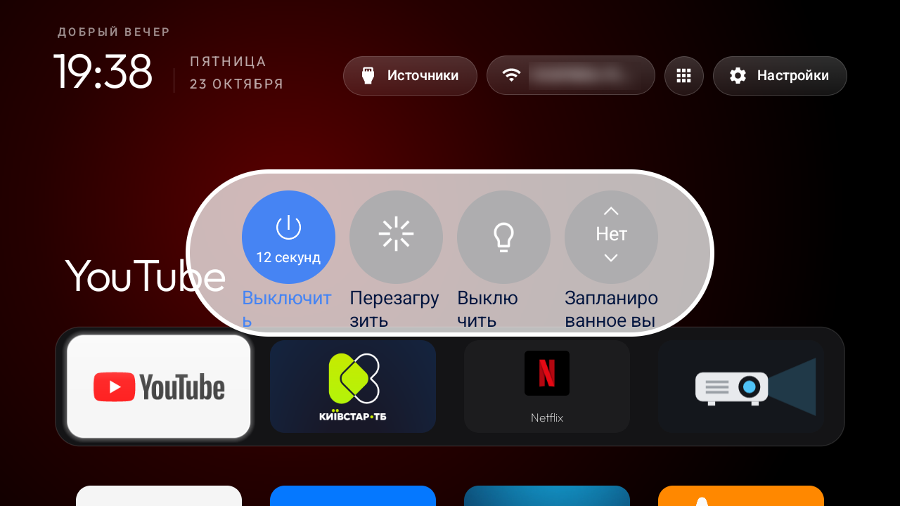

# XGODY Gimbal 3 Pro ("ADT-3", Allwinner H723): new launcher, projector settings app, setup scripts

> **Root for this projector:** <https://github.com/4TuNAs/Allwiner-H723-Obtaining-root-access>.
> Everything below needs Magisk root from there.

This projector runs a 32-bit Android 14 build on an Allwinner H723 (1 GB RAM, 1280×720 panel) that pretends to be a
Google **ADT-3**. Out of the box it has a slow vendor launcher, a pile of factory and OTA apps, a Play Store that
breaks itself on the first self-update, and keystone settings buried in the vendor app.

This repo replaces the parts that get in the way and keeps the parts the hardware needs:

- a fast **launcher** (a build of [cleanyourtv](https://github.com/Gathin23/cleanyourtv) set up for this projector);
- **Projector**, a settings app for what a projector actually needs: 4-corner keystone, zoom, projection mode,
  focus chart, picture settings, HDMI-CEC and power-on options, the remote in HDMI;
- **Magisk boot scripts** that keep Google Play working, run AirPlay/DLNA in the background and make the remote
  behave in HDMI;
- a **deploy script** that sets all of it up over ADB, saves a snapshot first, checks the result and can undo it.

Tested on two units (firmware builds of March and May 2026), both survive reboots.

| Home | Apps | Projector |
|---|---|---|
|  |  |  |

| Picture | Keystone | Focus chart |
|---|---|---|
|  |  |  |

| Projector (Russian UI) | Power key menu |
|---|---|
|  |  |

## What is in here

| Folder | What it is |
|---|---|
| [`apk/`](apk) | Ready builds: `tvhome-launcher.apk` (launcher) and `projector.apk` (Projector app) |
| [`projector-app/`](projector-app) | Source of the Projector app (Android Studio / Gradle project) |
| [`launcher/`](launcher) | The launcher config and the small patch on top of cleanyourtv, with its licenses |
| [`magisk/`](magisk) | Boot scripts for `/data/adb/service.d` |
| [`deploy/`](deploy) | `deploy.sh` (set up a projector), `undo.sh`, the debloat list, the parts that run on the device |
| [`docs/`](docs) | Screenshots and [notes on the firmware](docs/vendor-notes.md) |

## Requirements

- **Root with Magisk.** Getting root on this projector:
  <https://github.com/4TuNAs/Allwiner-H723-Obtaining-root-access>.
  In Magisk → Superuser, allow **Shell** (the deploy script uses `su` over ADB).
- `adb` and `bash` on the computer (Linux, macOS, WSL or Git Bash on Windows).
- ADB on the projector: Developer options → USB debugging. Network ADB on port 5555 is on by default in this
  firmware: `adb connect <projector IP>:5555`.

The launcher and the Projector app also install without root (`adb install -r apk/...`). The launcher then works
fully, Projector shows the screens but can not change anything: keystone, picture and the rest go through root.

## Quick start

```bash
git clone https://github.com/4TuNAs/XGODY-ADT3-New-Launcher
cd XGODY-ADT3-New-Launcher/deploy
adb devices                                   # note the serial, or ip:5555
SERIAL=<serial or ip:5555> ./deploy.sh --dry-run   # shows what it would do, changes nothing
SERIAL=<serial or ip:5555> ./deploy.sh             # does it, then runs 17 checks
```

Then reboot and, by hand:

1. Projector → **Keystone** and **Zoom** (every unit needs its own).
2. Google Play → Settings → Auto-update apps → **Don't auto-update apps**.
3. Install your apps from Google Play.

`deploy.sh` options: `--dry-run`, `--no-picture` (leave the HDMI picture mode alone), `--force` (run on a
firmware build it was not tried on; compare first). It can be run again: whatever is already done is skipped.

### What deploy.sh does

1. Checks the firmware build and root, saves a read-only snapshot to `deploy/backups/<serial>-<date>/`.
2. Installs the launcher and the Projector app.
3. On the projector, as root ([`device/apply.sh`](deploy/device/apply.sh)):
   - makes the new launcher Home;
   - disables the packages in [`disable.txt`](deploy/disable.txt) (factory tests, vendor store and OTA, stock
     players, unused AOSP parts; 44 packages, nothing is uninstalled);
   - keeps the vendor settings app enabled (the power key needs it), but hides its icon and its second Wi-Fi screen;
   - grants root to Projector in Magisk;
   - rolls Google Play back to the factory build and pins it there;
   - installs the Magisk boot scripts;
   - sets animations to 0.5× and turns HDMI-CEC on.
4. Opens HDMI for a few seconds and sets the picture mode to Standard.
5. Runs [`device/verify.sh`](deploy/device/verify.sh): 17 PASS/FAIL checks.

### Undo

```bash
SERIAL=<serial> ./undo.sh backups/<serial>-<date>
```

Re-enables what was disabled, gives Home back to the old launcher, removes the boot scripts, the root grant, the
launcher and Projector. Reboot afterwards.

## The Projector app

Two panels; Russian or Ukrainian system language gives a Russian UI, anything else English.

**Projector**

- **Keystone**: four corners, arrows move the corner, OK goes to the next one, Back finishes. Applied live through
  the Allwinner display service and kept by the display HAL across reboots.
- **Zoom**: shrinks the picture evenly, the keystone shape stays.
- **Projection**: front, rear, ceiling, ceiling + rear.
- **Picture**: mode, brightness, contrast, saturation, sharpness, colour temperature, HDMI signal type
  (auto / video / PC), reset to Standard. Values apply to HDMI. Like the vendor app, the sliders edit the "Custom"
  mode; moving one in another mode first copies that mode's values into Custom, so the picture does not jump.
  While HDMI plays, **Menu** on the IR remote opens the firmware's own picture panel over the picture.
- **Focus chart**: Siemens star, 1 and 2 px line groups in every corner, text from 10 to 26 px; OK inverts.
- **Reset geometry**.

**Device**

- **HDMI at startup**: opens HDMI after power-on.
- **Turn on with power**: power-on mode of the tv server (on with mains power, or standby until the remote).
- **HDMI-CEC**, **Wake with the source**, **Switch the source off too**: the framework's CEC settings.
- **Remote to the HDMI box**: in HDMI, Back and Home go to the box over CEC instead of closing HDMI; a long Back
  (0.7 s) or **Input/Source** leaves HDMI. Without a CEC device on HDMI they work as before. See below.
- **AirPlay / DLNA**: runs the vendor's tranScreen receivers in the background, without its full-screen app.
- **Faster interface**: all animation scales 0.5×.
- **Pair remote or gamepad**: the system Bluetooth accessory search (normal apps are not allowed to open it).

The **Settings** key on the IR remote opens Projector (see the boot scripts below).

How it works: the app starts one root helper (`app_process`, granted in Magisk) that loads the Allwinner display
and tv server classes straight from the vendor settings APK (`com.mylove.setting`) and calls the same services the
vendor app does. Nothing from the vendor is copied into this repo, which is why the vendor app must stay installed.

### Remote in HDMI

- HDMI is shown by `com.softwinner.awlivetv`. Its Back closes HDMI. The arrows and OK the firmware already passes
  to the box over CEC.
- `KeyService` (an accessibility service in Projector) takes Back and Home while HDMI is in front and sends them
  over CEC (`IHdmiControlService.sendKeyEvent`, through a small root helper that only runs while HDMI is open).
- **The firmware empties the accessibility service list on every focus change**
  (`DisplayContent.enableNfxAccessibility`, a Netflix hack), so no accessibility service survives on its own.
  [`magisk/cyt-keys.sh`](magisk/cyt-keys.sh) waits on the focused-app property (`resetprop -w sys.lmk_top_app`)
  and switches the service back on whenever HDMI comes to the front. Back goes to the box about 2 s after
  entering HDMI.
- Input/Source is handled by the firmware before any app sees it, and always jumps back into HDMI. The same script
  sees "HDMI → source picker", closes the picker and opens Home, so the button toggles between HDMI and Home.

## Magisk boot scripts

| Script | What it does | Undo |
|---|---|---|
| [`cyt-play-pin.sh`](magisk/cyt-play-pin.sh) | Every 30 min: if Google Play updated itself, remove the update (factory build). | `rm /data/adb/service.d/cyt-play-pin.sh`, re-enable Play's `SafeSelfUpdateService`, reboot |
| [`cyt-cast.sh`](magisk/cyt-cast.sh) | Keeps AirPlay / DLNA running while its switch in Projector is on. | `rm /data/adb/service.d/cyt-cast.sh`, reboot |
| [`cyt-keys.sh`](magisk/cyt-keys.sh) | Remote in HDMI (see above). | switch off in Projector, or `rm` the script and `/data/adb/cyt/keys`, reboot |
| [`cyt-settings-key.sh`](magisk/cyt-settings-key.sh) | The IR remote's Settings key opens Projector (the firmware sends it to the hidden vendor settings screen). Watches the IR receiver with `getevent`. | `rm /data/adb/service.d/cyt-settings-key.sh`, reboot |

## Firmware notes

The short version; details and the methods behind them in [docs/vendor-notes.md](docs/vendor-notes.md).

- **APKs must carry a v1 (JAR) signature**: a v2-only APK fails with `INSTALL_PARSE_FAILED_NO_CERTIFICATES`.
- **Google Play 53.x does not work** on this 32-bit build ("Check your Wi-Fi"): no native Cronet in its 32-bit
  split, and the system Cronet is too old for it. The factory build 34.1 works; keep it and turn auto-update off.
- **Chromecast built-in can not work**: Google's Cast receiver installs and shows up on phones, but Google refuses
  this device a Cast certificate (provisioning answers 403), so every phone drops the connection at
  authentication. Use DLNA (the AirPlay / DLNA switch) or the Web Video Caster Receiver app.
- **The power key opens `com.mylove.setting/.PowerActivity`** (power off / restart / screen off / sleep timer).
  Disabling the whole vendor settings app kills the power key; hide its launcher activity instead. The IR remote's
  **Settings** key also goes to that hidden screen, so `cyt-settings-key.sh` sends it to Projector.
- **The firmware wipes accessibility services on every focus change** (see above).
- **Input/Source and Menu are handled in `TvWindowManager.interceptKeyBeforeQueueing`**: Source opens
  `com.softwinner.awsource`, Menu over media apps broadcasts `com.mylove.DISPLAY_SETTINGS`.
- **Picture settings are per input**; right after power-on, before HDMI has been opened once, the tv server reports
  the "no source" values ("Cinema"). One unit had its HDMI picture on "Custom" at brightness 77 / contrast 71,
  far too bright; Standard is 50 / 50.
- **HDMI-CEC standby only turns the screen off** (`goToSleep`); the fan keeps running. Power off from the power
  key menu turns it off completely.
- **Network ADB is open on port 5555** without encryption. Turn debugging off when you do not need it.

## Building

**Projector app**: JDK 17 and Android SDK 34.

```bash
cd projector-app
echo "sdk.dir=$ANDROID_HOME" > local.properties
./gradlew assembleRelease      # app/build/outputs/apk/release/app-release.apk, debug-signed with v1 + v2
```

**Launcher**: upstream [cleanyourtv](https://github.com/Gathin23/cleanyourtv) at commit `34e1c42`, plus
[`launcher/local-changes.diff`](launcher/local-changes.diff) (v1 signing, dock, Inputs → HDMI, app library
button). See [launcher/README.md](launcher/README.md).

## Credits and licenses

- Launcher: [cleanyourtv](https://github.com/Gathin23/cleanyourtv) by Gathin, MIT
  ([launcher/LICENSE-cleanyourtv.txt](launcher/LICENSE-cleanyourtv.txt)).
- Font: [Outfit](https://github.com/Outfitio/Outfit-Fonts), SIL Open Font License 1.1.
- Root: [Magisk](https://github.com/topjohnwu/Magisk).
- Everything else here (Projector app, scripts): MIT, see [LICENSE](LICENSE).

Use at your own risk. Root and changing system apps may void the warranty; the deploy script saves a snapshot and
has an undo, but keep your own backups too.
